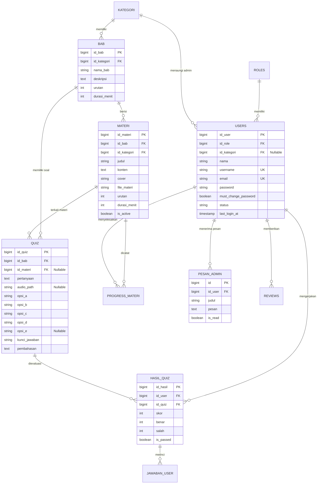

# PRODUCT REQUIREMENT DOCUMENT (PRD)
## SISTEM APLIKASI PEMBELAJARAN BAHASA INGGRIS INTERAKTIF (ENGLIFY)

---

### INFORMASI DOKUMEN & TIM PENGEMBANG

| Parameter | Keterangan |
| :--- | :--- |
| **Nama Produk** | **Englify (English Learning Gamified Platform)** |
| **Versi Dokumen** | **v2.0 (Final Production & UKK Standard)** |
| **Status** | Approved & Ready for Production / UKK Assessment |
| **Tanggal Pembaruan** | 25 Oktober 2026 |
| **Institusi** | **SMK Budi Bakti Ciwidey** |
| **Program Keahlian** | Rekayasa Perangkat Lunak (RPL) / Pengembangan Perangkat Lunak dan Gim (PPLG) |

#### Tim Pengembang:
1. **Anggia Tresa Putri** — *Backend & Database Developer*
   - Penanggung jawab arsitektur basis data, konsolidasi migrasi, Model Eloquent, Query Builder, API/Controller logic, Middleware otorisasi, dan Business Logic Rules.
2. **Nur Aprilia** — *Frontend Developer & UI/UX Designer*
   - Penanggung jawab perancangan antarmuka visual (UI/UX), komponen Blade Layouts, Tailwind CSS styling, integrasi Chart.js, modernisasi notifikasi SweetAlert2, dan interaksi interaktif pengguna.

---

### TECH STACK LENGKAP

```
+----------------------------------------------------------------------------------+
|                                    ENGLIFY                                       |
+----------------------------------------------------------------------------------+
|  FRONTEND LAYER                                                                  |
|  - HTML5 & Blade Templating Engine (Laravel Blade Components & Layouts)         |
|  - CSS Framework: Tailwind CSS v4.0 (Custom Palettes: Navy, Pastel, Glassmorphism)|
|  - Typography: Google Fonts (Plus Jakarta Sans, Inter, Caveat Handwriting)       |
|  - Interactive Alerts & Modals: SweetAlert2 v11 (Custom Clean Theme)             |
|  - Visual Charts: Chart.js (Statistik Progres Belajar & Skor Siswa)              |
|  - JavaScript: Modern Vanilla JS (ES6+) & Axios HTTP Client                      |
+----------------------------------------------------------------------------------+
|  BACKEND LAYER                                                                   |
|  - Programming Language: PHP 8.2+                                                |
|  - Web Framework: Laravel 12.x (MVC Architecture)                                |
|  - Timezone: Asia/Jakarta (WIB / GMT+7 - Real-Time Indonesia Barat)               |
|  - Security & Middleware: Role-Based Access Control, Force Password Change       |
|  - Package & Dependency Management: Composer 2.x                                 |
+----------------------------------------------------------------------------------+
|  DATABASE LAYER                                                                  |
|  - Database Management System: MySQL 8.x / MariaDB                              |
|  - Storage Engine: InnoDB (ACID Compliant)                                       |
|  - Migration Management: 14 Consolidated Clean Migrations (Zero Redundant Tables)|
|  - ORM: Laravel Eloquent ORM with Eager Loading Optimization                    |
+----------------------------------------------------------------------------------+
|  TESTING & DEVOPS LAYER                                                          |
|  - Automated Testing: PHPUnit 11.5+ (83 Feature & Unit Tests, 496 Assertions)   |
|  - Build Tool & Bundler: Vite v6                                                 |
|  - Version Control: Git & GitHub Repository                                      |
|  - System Modeling: Draw.io (ERD, Use Case, Flowchart, Activity Diagram)        |
+----------------------------------------------------------------------------------+
```

---

## 1. PENDAHULUAN & LATAR BELAKANG

### 1.1 Latar Belakang
Penguasaan Bahasa Inggris merupakan salah satu kompetensi esensial bagi siswa sekolah menengah kejuruan (SMK) untuk bersaing di dunia industri dan melanjutkan pendidikan. Namun, media pembelajaran konvensional seringkali monoton, minim media interaktif (khususnya listening), dan sulit dimonitoring progresnya secara terukur. Di samping itu, sistem ujian kuis daring konvensional kerap kali rentan terhadap kebocoran kunci jawaban dan tidak memiliki batasan pengerjaan waktu yang adaptif.

Aplikasi **Englify** hadir sebagai platform *Learning Management System (LMS)* modern bertema edukatif dan gamifikasi yang dirancang khusus untuk memfasilitasi pembelajaran bahasa Inggris berbasis kurikulum divisi (kategori) terstruktur.

### 1.2 Tujuan Produk
1. Memfasilitasi siswa belajar mandiri melalui modul materi digital yang terstruktur per Bab dan Kategori (Divisi).
2. Mengasah kemampuan menyimak (*listening comprehension*) melalui integrasi audio passage interaktif pada kuis.
3. Menjamin integritas ujian kuis daring dengan pembatasan durasi dinamis (*countdown timer*), pengacakan pilihan jawaban (*shuffled options*), dan **proteksi kunci jawaban** (hanya boleh ditinjau 1 kali saat submit).
4. Menyediakan sistem monitoring akademik yang transparan bagi Admin Divisi serta pengelolaan pengguna yang aman dan terpusat bagi Superadmin.

---

## 2. PENGGUNA SISTEM & MATRIKS HAK AKSES (USER ROLES)

Sistem Englify menerapkan prinsip **Separation of Concerns (Pemisahan Tanggung Jawab)** yang ketat dan dilindungi oleh middleware keamanan bertingkat:

```
+---------------------------------------------------------------------------------------+
| ROLE 1: SUPERADMIN                                                                    |
| Wewenang: Pengelolaan Akun Pengguna & Master Sistem                                   |
| - Mendaftarkan, memperbarui, dan menghapus Akun Siswa (kredensial: nama, email, pass).|
| - Mendaftarkan, memperbarui, dan menghapus Akun Admin Divisi (beserta id_kategori).   |
| - Mengubah status akun (Aktif / Nonaktif) -> Otomatis logout jika dinonaktifkan.      |
| - Melihat statistik jumlah akun terdaftar dan data integritas sistem.                 |
| - CATATAN: Superadmin TIDAK mengelola materi, bab, maupun bank soal quiz.             |
+---------------------------------------------------------------------------------------+
| ROLE 2: ADMIN DIVISI                                                                  |
| Wewenang: Pengelolaan Akademik, Kurikulum, & Evaluasi Divisi                          |
| - Mengelola Bab Kurikulum (Urutan, Deskripsi, Durasi Kuis Bab).                      |
| - Mengelola Materi Belajar (Konten, Cover, File Lampiran, Durasi Belajar, Toggle Mata)|
| - Mengelola Bank Soal Quiz (Pilihan ganda, Kunci Jawaban, Pembahasan, Audio Passage). |
| - Monitoring Nilai & Progres Belajar seluruh siswa pada divisinya.                    |
| - Mengirimkan pesan Pengingat (Reminder) broadcast maupun personal kepada siswa.      |
+---------------------------------------------------------------------------------------+
| ROLE 3: SISWA                                                                         |
| Wewenang: Pembelajar / Pengguna Akhir                                                 |
| - Login menggunakan Email & Password (Wajib ganti password pada login pertama).       |
| - Dashboard interaktif: Grafik progres, akumulasi poin, materi aktif, kuis terbaru.   |
| - Membaca materi belajar terurut dan membuka materi selanjutnya secara sequential.   |
| - Peta Quiz (Gamified roadmap): Mengikuti kuis berdurasi dengan opsi teracak.         |
| - Mengakses pembahasan review kuis HANYA 1 KALI saat submit kuis selesai.             |
| - Menerima dan mengelola pesan Reminder dari Admin Divisi.                            |
| - Melihat informasi profil akun (read-only) dan mengganti kata sandi akun mandiri.     |
+---------------------------------------------------------------------------------------+
```

### Matriks Wewenang Fitur

| Fitur / Modul | Superadmin | Admin Divisi | Siswa |
| :--- | :---: | :---: | :---: |
| **Kelola Akun Siswa & Admin Divisi** | **Penuh (CRUD)** | Tidak ada | Tidak ada |
| **Aktivasi / Nonaktivasi Akun Pengguna**| **Penuh** | Tidak ada | Tidak ada |
| **Dashboard Metrik Akun** | **Penuh** | Tidak ada | Tidak ada |
| **Kelola Bab & Kurikulum** | Tidak ada | **Penuh (CRUD)** | Hanya Lihat |
| **Kelola Materi Belajar & Dokumen** | Tidak ada | **Penuh (CRUD)** | Baca Materi |
| **Bank Soal Quiz & Audio Passages** | Tidak ada | **Penuh (CRUD)** | Kerjakan Quiz |
| **Monitoring Progres & Nilai Siswa** | Tidak ada | **Penuh** | Progres Sendiri |
| **Kirim Pesan Reminder / Motivasi** | Tidak ada | **Penuh** | Menerima Pesan |
| **Review Pembahasan Kunci Jawaban** | Tidak ada | Melihat Hasil | **1x (Saat Submit)** |
| **Review Publik Landing Page** | Tidak ada | Tidak ada | Buat Review |

---

## 3. SPESIFIKASI KEBUTUHAN FUNGSIONAL (FUNCTIONAL REQUIREMENTS)

### 3.1 Modul Autentikasi & Keamanan (Auth System)
* **FR-AUTH-01 (Login)**: Pengguna dapat masuk ke sistem menggunakan kombinasi **Email** dan **Password**. Sistem memvalidasi kredensial via Hash Bcrypt.
* **FR-AUTH-02 (Role Redirection)**: Sistem secara otomatis mengarahkan pengguna ke dashboard yang sesuai (Superadmin -> `/superadmin/dashboard`, Admin Divisi -> `/admin/dashboard`, Siswa -> `/siswa/dashboard`).
* **FR-AUTH-03 (Force Password Change)**: Akun siswa baru yang dibuat oleh Superadmin memiliki status `must_change_password = true`. Pada login pertama, siswa dipaksa masuk ke halaman `/change-password` dan tidak dapat mengakses menu lain sebelum mengganti kata sandi default.
* **FR-AUTH-04 (Account Status Enforcement)**: Middleware mendeteksi status pengguna pada setiap request. Jika status diubah menjadi `nonaktif`, sesi pengguna langsung dimatikan (*invalidated*) dan diarahkan keluar dengan pesan 403 Forbidden.
* **FR-AUTH-05 (Cross-Role Security)**: Middleware `EnsureUserHasRole` memblokir segala bentuk akses URL silang (misal: Siswa membuka URL `/admin` atau Admin membuka `/superadmin`).

### 3.2 Modul Superadmin (User & System Management)
* **FR-SA-01 (Manajemen Siswa)**: Superadmin dapat melihat daftar siswa, menambah siswa baru, memperbarui nama/email/password, mengubah status (aktif/nonaktif), dan menghapus siswa. Data yang digunakan murni **Nama, Email, dan Password** (tanpa nomor telepon). Username dibuat otomatis secara unik dari slug email.
* **FR-SA-02 (Manajemen Admin Divisi)**: Superadmin dapat mendaftarkan akun Admin Divisi serta mengaitkannya dengan Divisi Bahasa Inggris tertentu (`id_kategori`).
* **FR-SA-03 (Real-Time Search)**: Menyediakan API pencarian cepat pengguna global berdasarkan nama atau email.
* **FR-SA-04 (Dashboard Statistik Akun)**: Menampilkan jumlah riil akun Siswa aktif, akun Admin Divisi, jumlah Divisi, dan riwayat pertumbuhan akun per bulan.

### 3.3 Modul Admin Divisi (Curriculum & Learning Management)
* **FR-AD-01 (Manajemen Bab)**: Mengelola master Bab per divisi, termasuk penomoran urutan bab, deskripsi kompetensi, dan pengaturan default durasi kuis bab. Menghapus bab menerapkan *cascade delete* pada materi dan kuis di bawahnya.
* **FR-AD-02 (Manajemen Materi)**: Menambah materi belajar teks kaya (*rich text*), mengunggah berkas gambar/cover, file dokumen lampiran, dan mengatur visibilitas materi (*active/hidden toggle*).
* **FR-AD-03 (Bank Soal & Audio Passage)**:
  - Membuat soal pilihan ganda (4-5 opsi jawaban) lengkap dengan penentuan kunci jawaban yang benar dan pembahasan rincinya.
  - Mengunggah berkas audio listening (`.mp3`, `.wav`) yang otomatis terintegrasi dengan pemutar audio HTML5 pada halaman pengerjaan kuis siswa.
* **FR-AD-04 (Monitoring Evaluasi)**: Menampilkan tabel rekapitulasi progres seluruh siswa di divisinya: akumulasi poin gamifikasi, persentase materi yang telah dibaca, dan riwayat perolehan skor kuis.
* **FR-AD-05 (Kirim Reminder)**: Mengirimkan pesan pengingat/motivasi langsung ke kotak masuk notifikasi siswa.

### 3.4 Modul Siswa (Learning & Assessment)
* **FR-SW-01 (Dashboard Siswa)**: Menampilkan grafik visual progres belajar (Chart.js), total materi yang telah dikuasai, total poin reputasi, kartu ringkasan kuis, dan pesan pengingat belum dibaca.
* **FR-SW-02 (Pembelajaran Materi Sequential)**: Siswa membaca materi per bab. Saat materi diselesaikan, sistem mencatat record di tabel `progress_materi` dan menambahkan poin siswa secara aman.
* **FR-SW-03 (Peta Quiz / Roadmap)**: Menampilkan jalur kuis interaktif yang terbuka secara bertingkat berdasarkan kelulusan materi dan kuis bab sebelumnya.
* **FR-SW-04 (Pengerjaan Kuis & Timer Dinamis)**:
  - Siswa mengerjakan kuis dengan waktu mundur (*countdown timer*) yang diambil dari `durasi_menit` materi/bab.
  - Pilihan ganda diacak susunannya (*shuffled options*) untuk menjaga kejujuran ujian.
  - Jika waktu pengerjaan habis, lembar jawaban otomatis terkumpul (*auto-submit*).
* **FR-SW-05 (Pembatasan Review Pembahasan & Kunci Jawaban)**:
  - Kunci jawaban dan pembahasan rinci **HANYA DITAMPILKAN 1 KALI**, yaitu tepat saat siswa menekan tombol "Selesai Kuis" bersamaan dengan modal perayaan skor kelulusan.
  - Pada halaman Riwayat Kuis / Lihat Hasil Kuis (`/siswa/quiz/{id}/hasil`), sistem hanya menampilkan perolehan nilai, akurasi, dan tanggal pengerjaan. Daftar soal, pembahasan, dan kunci jawaban disembunyikan total untuk mencegah kebocoran soal antar siswa.
* **FR-SW-06 (Kotak Masuk Reminder)**: Siswa dapat membaca pesan pengingat dari Admin, menandai sudah dibaca, menghapus pesan tertentu, atau menghapus semua pesan dengan konfirmasi SweetAlert2.
* **FR-SW-07 (Profil & Keamanan Akun Siswa)**: Siswa dapat melihat informasi profil akunnya (Nama Lengkap, Email, Tanggal Bergabung, Waktu Terakhir Login) yang bersifat **Read-Only** (hanya baca). Siswa **tidak dapat mengubah nama atau profil/email sendiri** guna menjamin konsistensi data akademik sekolah (perubahan nama/email hanya dapat diproses oleh Superadmin). Avatar profil digenerate secara otomatis dari inisial huruf pertama nama siswa (tanpa fitur unggah foto). Fitur mandiri yang dapat dilakukan siswa pada menu profil adalah **Ganti Password (Update Password)** dengan verifikasi password lama, password baru minimal 6 karakter, dan konfirmasi password baru.

### 3.5 Modul Publik & Ulasan (Landing Page)
* **FR-PUB-01 (Landing Page)**: Menyajikan informasi profil Englify, keunggulan kurikulum, statistik publik, dan ulasan pengguna.
* **FR-PUB-02 (Form Review)**: Pengguna/siswa dapat mengirimkan testimoni ulasan beserta penilaian bintang (1 - 5) yang langsung tampil pada landing page.

---

## 4. SPESIFIKASI KEBUTUHAN NON-FUNGSIONAL (NON-FUNCTIONAL REQUIREMENTS)

| Kategori | Spesifikasi & Standar Implementasi |
| :--- | :--- |
| **Keamanan (Security)** | - Enkripsi kata sandi menggunakan algoritma **Bcrypt**.<br>- Perlindungan serangan **CSRF** pada seluruh form POST/PUT/DELETE via token Laravel.<br>- Pencegahan **SQL Injection** dengan Prepared Statements Eloquent ORM.<br>- Sanitasi input teks publik menggunakan `strip_tags()` untuk menangkal serangan **XSS**.<br>- Proteksi sesi ganda dan auto-invalidation untuk akun nonaktif. |
| **Kinerja (Performance)** | - Optimasi query database dengan metode *Eager Loading* (`with(['kategori', 'bab'])`) untuk mengeliminasi masalah N+1 Query Problem.<br>- Paginasi data (10 data per halaman) untuk mempercepat waktu render tabel.<br>- Waktu respons halaman rata-rata < 1.2 detik pada server lokal/intranet. |
| **Keandalan Data (Reliability)** | - Penggunaan *Foreign Key Constraints* dengan `onDelete('cascade')` atau `onDelete('set null')` guna menjamin tidak adanya *orphaned records* saat data induk dihapus.<br>- Operasi pembaruan progres dan poin dibungkus dalam blok transaksi database (`DB::transaction`). |
| **Antarmuka & Ergonomi (Usability)** | - Desain responsif (*Mobile First & Desktop Friendly*) menggunakan utility-first Tailwind CSS v4.<br>- Penggantian seluruh fungsi dialog browser primitif (`alert()`, `confirm()`) menggunakan modal interaktif modern **SweetAlert2**.<br>- Tipografi ramah mata menggunakan kombinasi Google Fonts *Plus Jakarta Sans* dan aksen *Caveat*. |
| **Kepatuhan Pengujian (Testing)** | - Memiliki suite pengujian otomatis **PHPUnit** dengan cakupan 83 skenario pengujian fungsional dan 496 assertions (100% Passed). |

---

## 5. ARSITEKTUR BASIS DATA & SKEMA ENTITAS

Basis data Englify menggunakan 14 tabel migrasi yang telah terkonsolidasi rapi dan terhindar dari redundansi:



### Rincian Tabel Basis Data:
1. `roles`: Master peran pengguna (`1` = Superadmin, `2` = Admin Divisi, `3` = Siswa).
2. `kategori`: Divisi/kategori kurikulum pembelajaran bahasa Inggris (contoh: General English, Business English, TOEFL Prep, Grammar Club).
3. `users`: Entitas akun pengguna. Kredensial murni Nama, Email, Password, dan Status. **Tidak menggunakan nomor telepon**.
4. `bab`: Unit pengelompokan kurikulum materi di bawah divisi/kategori.
5. `materi`: Konten teks, bahan ajar digital, durasi belajar, dan dokumen panduan siswa.
6. `referensi`: Sumber pustaka dan rujukan materi belajar.
7. `progress_materi`: Pencatatan log siswa yang telah membaca dan menuntaskan materi belajar.
8. `quiz`: Bank soal evaluasi pilihan ganda lengkap dengan passage audio listening dan kunci/pembahasan.
9. `hasil_quiz`: Rekapitulasi perolehan nilai, jumlah benar/salah, dan status kelulusan kuis siswa.
10. `jawaban_user`: Riwayat pilihan jawaban spesifik siswa untuk audit pengerjaan.
11. `pesan_admin`: Tabel notifikasi pengingat/reminder yang dikirim dari Admin Divisi ke Siswa.
12. `reviews`: Ulasan dan testimoni rating bintang yang diberikan pengguna untuk landing page.
13. `sessions`: Penyimpanan sesi otentikasi login berbasis database driver.
14. `cache`: Caching internal sistem untuk performa query data.

---

## 6. ALUR LOGIKA BISNIS UTAMA (BUSINESS LOGIC WORKFLOWS)

### 6.1 Alur Registrasi Siswa & Paksa Ganti Password
```
[Superadmin] -> Input Form Tambah Siswa (Nama, Email, Status)
     |
     v
[Sistem] -> Generate Username Unik + Password Awal (password123) + Set must_change_password = true
     |
     v
[Siswa] -> Login Menggunakan Email & Password Awal
     |
     v
[Middleware ForcePasswordChange] -> Mendeteksi must_change_password == true
     |
     v
[Sistem] -> Paksa Redirect ke Halaman /change-password (Semua Menu Lain Dikunci)
     |
     v
[Siswa] -> Input Password Baru (Min 6 Karakter) & Konfirmasi
     |
     v
[Sistem] -> Simpan Hash Password Baru, Update must_change_password = false
     |
     v
[Siswa] -> Diarahkan Masuk ke Dashboard Siswa Penuh
```

### 6.2 Alur Pengerjaan Kuis, Countdown Timer, & Isolasi Pembahasan Kunci Jawaban
```
[Siswa] -> Membuka Halaman Quiz (/siswa/quiz/{id})
     |
     v
[Sistem] -> Menghitung Durasi Menit (Materi/Bab) & Mengacak Opsi Jawaban (Shuffled)
     |
     v
[Siswa] -> Mengerjakan Soal + Mendengarkan Audio Passage (Jika Ada)
     |
     +---> [Waktu Habis / Tombol Selesai Diklik]
     |
     v
[Sistem] -> Evaluasi Jawaban, Hitung Skor, Simpan ke tabel hasil_quiz
     |
     v
[Sistem] -> Set Flash Session (can_review_quiz = true, show_celebration = true)
     |
     v
[Siswa] -> Pop-up Modal Perayaan Muncul: Skor & SATU-SATUNYA KESEMPATAN LIHAT PEMBAHASAN
     |
     v
[Siswa Menutup Modal / Berpindah Halaman] -> Session Flash Hangus
     |
     v
[Siswa Membuka Kembali Riwayat Kuis /siswa/quiz/{id}/hasil di Kemudian Hari]
     |
     v
[Sistem] -> Koleksi Soal & Kunci Jawaban DIKOSONGKAN (Mencegah Kebocoran Soal)
     |
     v
[Tampilan] -> Hanya Menampilkan Ringkasan: Skor Akhir, Akurasi, dan Tanggal Pengerjaan
```

---

## 7. RENCANA PENGUJIAN OTOMATIS & VERIFIKASI (QUALITY ASSURANCE)

Sistem telah diuji secara komprehensif menggunakan **PHPUnit 11.5+** dengan hasil **83 Tests, 496 Assertions, 0 Failures**:

| Test Suite File | Fokus Pengujian | Status |
| :--- | :--- | :---: |
| `AdminLoginTest.php` | Otentikasi login admin, validasi sesi, proteksi guest | **PASSED** |
| `AdminMateriBabGroupingTest.php` | Pengelompokan materi per bab dan integritas relasi foreign key | **PASSED** |
| `BabCascadeDeleteTest.php` | Integritas cascade delete bab -> materi -> quiz | **PASSED** |
| `CurriculumWithoutSubbabTest.php` | Kurikulum efisien Bab langsung Materi (tanpa subbab redundan) | **PASSED** |
| `MateriPreviewAndEyeToggleTest.php`| Fitur pratinjau materi dan visibilitas sembunyi/tampil materi | **PASSED** |
| `MonitoringTotalPoinTest.php` | Kalkulasi akumulasi poin belajar dan total nilai kuis siswa | **PASSED** |
| `PasswordChangeVerificationTest.php` | Alur paksa ganti password siswa baru pada login perdana | **PASSED** |
| `QuizAudioPassageTest.php` | Unggah berkas audio listening dan validasi pemutar audio | **PASSED** |
| `QuizTimeLimitAndShuffledOptionsTest.php`| Kepatuhan durasi timer kuis dan pengacakan pilihan jawaban | **PASSED** |
| `RoleSecurityMiddlewareTest.php` | Proteksi otorisasi hak akses URL silang (Cross-role authorization) | **PASSED** |
| `RouteSmokeTest.php` | Verifikasi status HTTP 200/302 pada seluruh 81 named routes | **PASSED** |
| `SiswaReviewAndSidebarTest.php` | Pembatasan 1x review pembahasan kuis dan validasi typo sidebar | **PASSED** |
| `UserStatusNonaktifSecurityTest.php`| Pemutusan sesi otomatis seketika saat user dinonaktifkan | **PASSED** |

---

## 8. KESIMPULAN

Dokumen PRD ini menjadi acuan spesifikasi resmi dan panduan pengujian fungsionalitas sistem aplikasi **Englify**. Dengan pemisahan peran yang tegas (*Superadmin mengelola akun; Admin Divisi mengelola materi, bab, kuis, dan monitoring; Siswa belajar dan mengerjakan kuis*), arsitektur database yang bersih (14 migrasi konsolidasi), antarmuka modern Tailwind CSS & SweetAlert2, serta proteksi kunci jawaban kuis yang ketat, aplikasi Englify dinyatakan **100% siap untuk Uji Kompetensi Keahlian (UKK) dan rilis produksi**.
